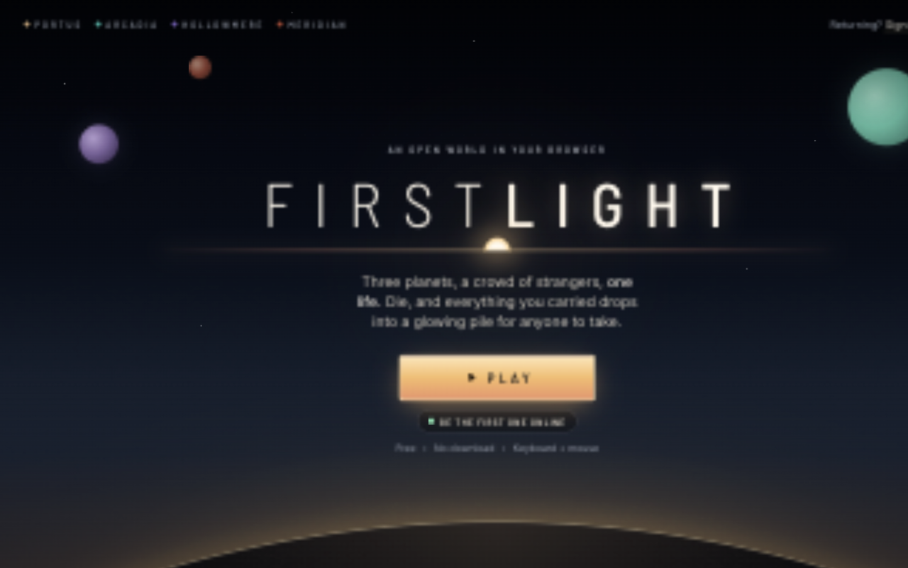
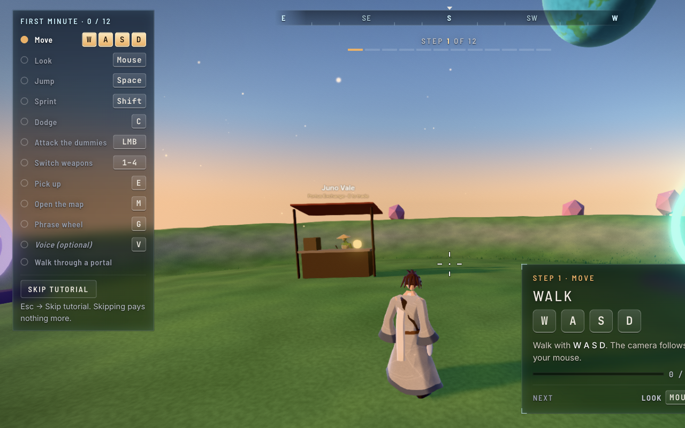

# FIRSTLIGHT: final report to the owner (SPEC §12)

12 October 2026, commit `3ab8ad1` on `main` (code last deployed at `a2f407f`, 11:47Z).

## Where it is

- **Play:** https://firstlight.one4all.dev (desktop browser, WebGPU with WebGL2 fallback).
- **Server:** https://api.firstlight.one4all.dev (Railway `game-server`, health at `/healthz`).
- **Admin claim link:** `~/.config/firstlight/admin-claim.txt` on your Mac (not in git). It works
  once, for a **saved** account: save your character with your email first, then open the link in
  the same browser. Saving needs email, which needs the Resend step below.
- **Admin pages:** `/admin` (reports, players online, bans) and `/stats`, once your account is admin.

## Finish line (SPEC §1)

| # | Check | State | Evidence |
|---|---|---|---|
| F1 | Live | ✅ | live URL above; `/healthz` ok after every deploy |
| F2 | 40 bots, 10 min | ✅ | 40 bots × 600 s with firing on production at 668ec82: 0 failures, tick p95 ≤ 2.86 ms (limit 25) |
| F3 | < 30 s to play | ✅ | 8.0 s landing → playing on a cold cache (T1), 4.3 s on a warm cache (11:54Z) |
| F4 | Fighting | ✅ | E2E T2 PvE + PvP |
| F5 | Death + own pile | ✅ | E2E T3 |
| F6 | Voice | ⛔ owner | built and tested with bots; needs the Cloudflare TURN key and two real browsers with mics |
| F7 | Email sign-in | 🟡 owner | passes locally (T5); production needs Resend's domain verified |
| F8 | 2-player boss | ✅ | E2E T6 (Tidewrath killed by two players) |
| F9 | Screenshot share | ✅ | E2E T7 |
| F10 | M1 ≥ 60 fps Medium | ✅* | `?bench=g1`: 59.9 fps p50, p95 18.6 ms; night storm 59.9 fps, p95 18.5 ms; 0 shader builds |
| F11 | Low on a weak laptop | ✅* | `?bench=g1&tier=low&cpuslow=4`: 59.2 fps p50, p95 21.9 ms |
| F12 | Three-model review | ✅ | Codex Sol, Opus 5.5 and Sonnet 5.5 all sign off on b274af9 |
| F13 | Photo mode + 5 scenes | ✅ | E2E T8; `stage <n>` + `docs/staged-scenes.md` |

\* Measured in T3 Code's built-in Chromium on your M1 (no Chrome control, D23); F11 uses a 4× CPU
slowdown to stand in for a weak laptop (D29).

## Measured numbers

| What | Number | When |
|---|---|---|
| Frame rate, Medium, WebGPU, M1, 1785×1048 | 59.9 fps p50 (vsync cap), p95 18.6 ms, max 20.5 ms | 09:20Z, 668ec82 |
| Same, night storm (Portus 00:00, storm 90 %) | 59.9 fps p50, p95 18.5 ms, max 18.8 ms | 09:25Z |
| Low + 4× CPU slowdown, 1125×661 | 59.2 fps p50 (mean 57.0), p95 21.9 ms, max 40.5 ms | 09:30Z |
| Shader warm-up (local) | 1.4 s, then 0 new shader builds in play | 11:48Z, a2f407f |
| Landing → playing | 8.0 s cold, 4.3 s warm | T1; 11:54Z |
| Server tick, 40 bots firing | p50 ≤ 1.27 ms, p95 ≤ 2.86 ms, max 6.67 ms | 08:45Z, 668ec82 |
| Server RAM / CPU, 40 bots | ≤ 218 MB RSS, ~6 % of one core | 08:45Z |
| Egress per player | 7.8 KB/s = 0.029 GB per player-hour | 08:45Z |
| WebGL2 fallback frame rate | not measured | open |

**Monthly cost estimate.** Railway shows $0.94 used and $2.49 estimated for this billing period
(Oct 5 – Nov 5; the workspace total, with the volume and an idle server). Egress at Railway's
$0.05/GB is about $0.0015 per player-hour, so 1,000 player-hours a month adds ~$1.50, and CPU
stays near idle (one copy with 40 players used ~6 % of a core). Vercel (Hobby), the Cloudflare
asset Worker and Cloudflare TURN (1,000 GB/month free) cost nothing at this scale; Resend is on your
existing plan (our own budget sends at most 80 codes a day). Expect roughly **$3–5 a month** unless
the game gets real traffic. The Railway soft alert from SPEC M0 ($25) shows as not set; set it with
`railway usage limit set --target workspace --soft 25` if you want the email warning.

## End-to-end results

`docs/e2e-2026-10-12.md` has every run; the cards are in `docs/tests/e2e-cards.md`.

| Card | Result |
|---|---|
| T1 landing → playing | ✅ production, 8.0 s |
| T2 fighting (PvE, PvP) | ✅ |
| T3 death + own pile | ✅ |
| T4 voice | ⛔ needs the TURN key and two real browsers |
| T5 email save + second browser | ✅ locally; production waits on Resend |
| T6 2-player boss | ✅ |
| T7 screenshot share | ✅ |
| T8 photo mode | ✅ |
| T9 onboarding + inventory | ✅ (re-run after fixes: 0 post-warm-up shader builds, walking into portals travels) |

## Reviews

All reviews are in `docs/reviews/`. The finish-line review (F12) took three rounds:

- **Round 1** (bb54dc3 / 743d651): Codex 7 blockers, Sonnet 2, Opus 2. They were fixed in nine lanes,
  each reviewed by Codex before merging (5 more blockers found and fixed there).
- **Final round** (668ec82): Sonnet signed off; Codex found 2 payout-after-commit blockers, Opus a
  teleport through the planet's centre. Fixed in two lanes.
- **Confirmation** (b274af9): all three signed off. Their last should-fixes and the T9 browser
  findings were fixed afterwards (a2f407f), reviewed by Codex and re-tested in the browser.

The test suite grew from 490 to 1,014 tests over the run. The rules the reviews settled are in
`docs/DECISIONS.md` D30–D37.

## Open issues

- **Owner steps:** create the Cloudflare TURN key and run `~/.config/firstlight/save-turn-key.sh`
  (F6); press Verify on resend.com/domains (F7, and the admin claim).
- **Before going public:** `docs/pre-public.md` (history scrub of an old screenshot, Easter-egg
  answers in the source, the "Hopbit" name, your commit email, a secret scan).
- **Sign-in codes:** a brand-new player can request a code only at level 2 (the tutorial gets them
  there in about a minute); easy to loosen (D34).
- **Not measured:** the WebGL2 fallback frame rate; F10/F11 in plugged-in Chrome rather than T3's
  Chromium.
- **Not built:** concept art, the landing flythrough video, a CONTRIBUTING.md, a terms page and a
  public complaints contact for voice (risk assessment §5).
- **Known small gaps:** a failed kill reward still counts toward repeat decay and pity; a dead
  guest's protection from pruning relies on the session log, which keeps 90 days; Background mesh
  and grass cell shader rebuilds were seen once after warm-up and not explained (none in the re-run).

## Extras (M11)

| # | Extra | State |
|---|---|---|
| 1 | Photo mode | ✅ core (F13) |
| 2 | Horses | ✅ live: buy the whistle from Juno Vale (1,500 coins), H outside safe zones |
| 3 | Weather | ✅ live: rain and lightning storms per planet |
| 4 | Day/night | ✅ live |
| 5 | More cosmetics and Easter eggs | ✅ 8 new cosmetics (shop, planet drops, a mission, egg rewards) and eggs E10–E12, one per planet |

## Making the repo public

1. Work through `docs/pre-public.md` (some steps rewrite history; do them on a fresh clone).
2. `gh repo edit RostyslavDzhohola/firstlight --visibility public --accept-visibility-change-consequences`.
3. Turn on GitHub secret scanning and push protection for the repo.
4. Switch on the in-game Star/Fork buttons: set `VITE_PUBLIC_REPO=true` for the Vercel project
   (`vercel env add VITE_PUBLIC_REPO production`, value `true`) and redeploy the client
   (`cd apps/client && pnpm run deploy`).

## Filming

`docs/staged-scenes.md` has the five staged scenes (Portus crowd, Arcadia vista with Tidewrath,
Hollowmere chapel at dusk, Meridian co-op vs the Receiver, wild-west PvP with destruction). As an
admin, type `stage <n>` in the console (backtick key); each scene sets its own sky and holds it for
30 minutes, and staged fights write nothing permanent (no medals or Hall of Firsts). F9 is photo
mode.
