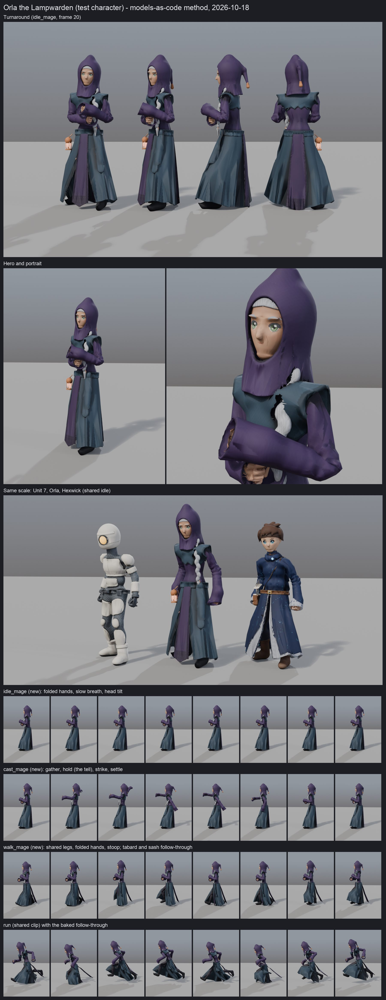
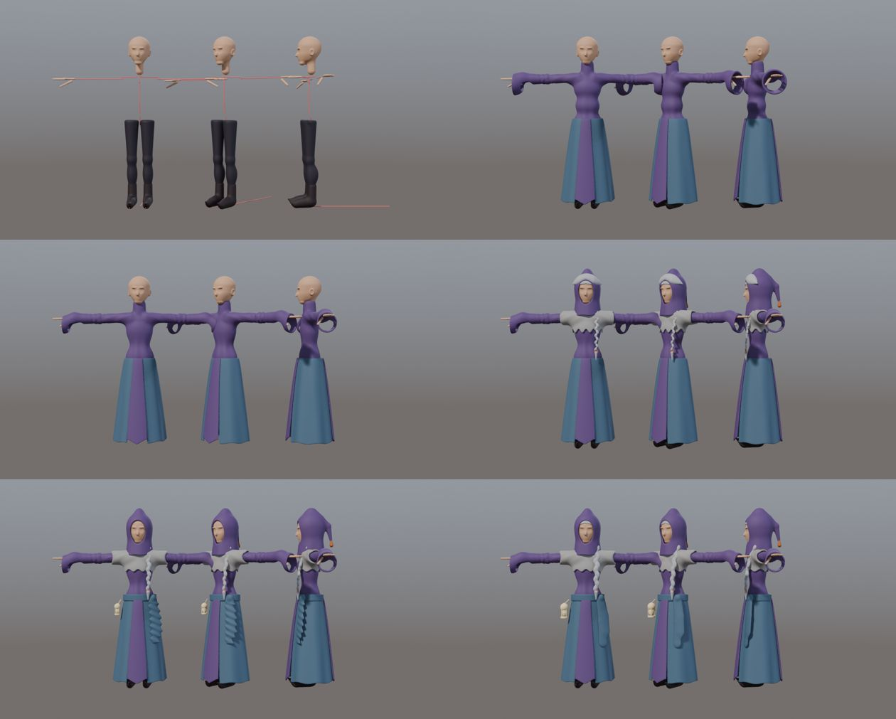
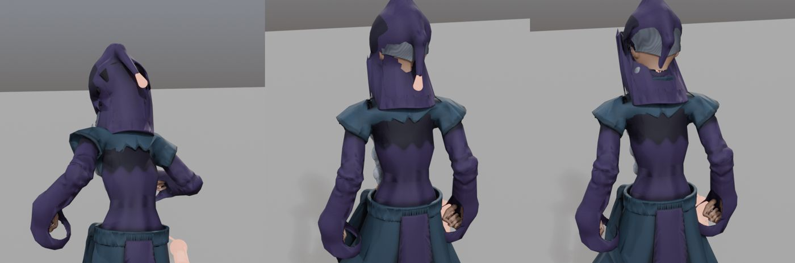

# Models-as-code test: one new character, overnight (2026-10-18)

**What:** an overnight test (branch `lane/chars-mage`, not merged, not deployed) of the improved "models as
code" method from rewind02's two posts, on one new character: **Orla the Lampwarden** (working name), a
tall, slim, hooded elder. Opus did all the work; Blender ran headless; nothing used Higgsfield or any
other paid generation.

**Verdict:** the method works and is worth keeping, with changes. The two steps that paid off most were
**the per-part preview loop** (it caught seven problems in five parts in about 9 minutes) and **the clip check**
(it found real faults in the swing bake that looked fine in T-pose: 195 flags in round 1, 41 at the end,
after the Codex review added upper-arm capsules that catch contacts the earlier rounds missed). The weakest step is **T-pose-only previews of cloth**: the capelet and sleeves looked right in
T-pose and wrong once the arms came down. Fixing that means previewing in a pose, not only in T-pose.

## Numbers

| | Orla (test) | Hexwick (shipped) | Unit 7 (shipped) |
|---|---:|---:|---:|
| Triangles | 16,363 | 15,068 | 13,927 |
| Joints | 65 shared + 12 extra | 65 | 65 |
| Mesh GLB, meshopt (same `gltf-transform optimize` flags as `build.sh`) | 254,868 B | 218,524 B | 210,952 B |
| Albedo WebP 1024² / 512² | 182,792 / 86,154 B | 198,848 / 89,152 B | – |
| Normal WebP 1024² / 512² | 259,238 / 97,950 B | – | – |
| Clips GLB, meshopt | `mage_anims.glb` 1,578,216 B (29 clips) | `starters_anims.glb` 1,134,936 B (26 clips, shared) | shared |

The mage carries its own clips file because it has extra bones with keyed swing; the 26 shared clips
are inside it again, plus 3 new ones.

**Time** (wall clock, on the owner's Mac): brief and recipe set-up 00:00–00:05; six part previews
00:05–00:14 (30–60 s each); first full build 4 min 41 s; first clip-check round at 00:23; three fix rounds
until 00:48; first contact sheet 00:51; Codex review, its fixes, the re-bake and the final sheet after that. Four full builds in total (281 s, one
killed, 648 s while two other builds ran, 194 s). One `mage_anims` bake of all 29 clips plus swing:
about 1 min 50 s. One clip check over all 29 clips: about 13 s.

## Step by step: what worked and what didn't

1. **Short brief and 2–3 references for the feel** (recipe header): a heron in shallow water, a
   lighthouse keeper at dusk, paper lanterns. *Worked.* It gave clear tie-breakers: tall and still,
   stooped forward; the lantern is the character; things swing softly. The head stoop, folded hands and
   swinging lantern all came from it. The IP avoid list (no pointed brimmed hat, no long white beard, no
   grey-robe-grey-hat, no orb staff, nothing from Hexwick's or Ash's lists, §8.2) shaped the hood and
   braid. **She must not be called "Vesper":** content.md §10 already rejects it.
2. **Build part by part with a preview after each** (`preview_parts.py`, front, 3/4 and side in one
   image). *Worked best of all.* Seven problems in five parts showed up on the first try and were fixed before the slow build:
   a goatee-like chin, a bodysuit-tight robe top, ring-like cuffs, hair poking out of the hood like a
   white brim, a thin twisted braid, spiky capelet scallops and ribbed sash tails. Each fix took one
   edit and a 30–60 s preview. *Didn't work:* every preview is in T-pose, so it can't show cloth that
   breaks when the arms come down (see 7).

   
3. **Rig on the shared skeleton plus extra bones** (`extra_bones.py`, hook in `build.py`;
   `EXTRA_BONES` in the recipe). *Worked.* All 65 shared joints match `rig_rest.json` exactly (max
   deviation 0.000002 m), so every shared clip still plays; 12 extra bones (hood tip ×2, braid ×3, front
   and back tabard ×2 each, sash ×2, lantern ×1) export in the GLB. *Didn't work at first:* the chain
   weights had no distance limit, so the tip bone dragged the whole back of the hood into a box; fixed
   with a reach falloff in `chain_w`. Also, wide sleeves must follow the forearm, not the hand.
4. **Signature clips keyframed in Python** (`mage_anims.py`). *Worked:* `idle_mage` (folded hands,
   breath, a slow head tilt), `cast_mage` (gather, a 7-frame hold as the tell, strike, settle; 50
   frames) and `walk_mage` (shared legs, folded hands, stoop). Direction keys on a few bones are quick to
   write and read well side-on. *Limits:* aiming a bone's axis can't express twist, so head turns are
   tilts only; the folded-hands pose needed one fix (forearms crossed).
5. **One 1024 albedo (+512)**: the existing bake did this unchanged; sizes are in line with the other
   starters.
6. **Clip check** (`clip_check.py`). *Worked, and earned its keep.* It first proves the bind pose is
   the real rest pose from `rig_rest.json`, not a clip's first frame: the clips' first frames put the hands
   0.3–1.9 m away from rest, which is what "rest pose = frame 0" would have baked in. Then it plays all
   29 clips and measures hands and props entering capsules around the body under the clothes, against a
   rest-pose baseline. Round 1 found 195 flags; I rendered the worst ones and most were real:

   

   - the swing bake's gravity pulled the hood tip, which already hangs in the rest pose, into the back
     of the head (fixed: gravity now only acts by as much as the parent has turned since rest);
   - the braid swung into the body when running, and the lantern into the right arm (fixed: more
     colliders);
   - the tabard hems crossed the shins (improved: colliders now push each bone's middle as well as its
     tail);
   - false positives: sleeve cuffs weighted to the hand bone counted as "hand" (fixed in the recipe).

   | Round | Flags | Clips with no flags |
   |---|---:|---:|
   | 1 (first bake) | 195 | 0 of 29 |
   | 2 (gravity, weights, colliders) | 51 | 13 |
   | 3 (mid-point colliders, new folded pose) | 35 | 16 |
   | final build (capelet and sleeves) | 35 | 16 |
   | after the Codex review (upper-arm capsules, recipe bone lengths, joint constraint solve, settled loops) | 41 | 13 |

   The 41 left: 24 are the tabards (each is one wide panel on one bone chain, so its side edges cut a
   shin whenever the legs split: run, sprint, roll, jumps, heavy melee, swim), 9 the braid (4 of them the
   right upper arm swinging across the chest into it in melee; 1.6–4.9 cm), 4 the sash, 3 hands in shared
   clips that really do touch the thighs (death, roll), 1 the lantern. Clean: idle, walk, cast, block,
   fall, hit, both punches, cheer, point, wave, and the new `idle_mage` and `cast_mage`. The bake itself
   reports 37 bone-frames it couldn't push out of a collider (`swing-stats.json`), mostly swim (13) and
   melee_heavy (8).
   Full results: `2026-10-18-chars-mage-test/clipcheck-round1.json`, `clipcheck-final.json`,
   `swing-stats.json`.
7. **Contact sheet** (`contact_sheet.py`, from `render.py` turnaround, hero, portrait, line-up and clip
   frames). *Worked*, and it was where the last two faults showed: the capelet rising into points at the
   shoulders and cone-like sleeves once posed. I pinned the capelet to the shoulders and narrowed the
   cuffs; the shoulder points are smaller but still there (see the line-up row).

## Codex review (gpt-6.1-sol, high)

Five findings, all accepted and fixed on the branch:

1. **Collider push could break the angle limit** (the lantern reached 113.6° against a 50° limit in
   swim). Now the collision push and the angle limit alternate up to four times per substep, with the
   limit last, so it always holds; whatever is still inside a collider is counted and reported.
2. **Loops didn't close** (81.7° seam on the sash in swim). Loops now simulate their unique frames
   (the duplicated end frame is skipped), settle for up to six cycles, record one, and ease the last
   quarter (at most 8 frames) into the first frame. Before easing, the worst seams are 23° (sprint) and
   21° (run): those clips aren't perfectly periodic; every other loop is under 8°.
3. **Spring lengths came from the glTF importer's guesses** (lantern 0.104 m instead of 0.211 m;
   glTF has no bone tails). The bake now takes the lengths from the recipe's `EXTRA_BONES`.
4. **No upper-arm capsules in the clip check**, so the braid crossing the arm passed clean. Added; the
   braid also got an upper-arm collider (the worst case went from 4.4–4.7 cm to 1.8–1.9 cm in aim and
   shoot). This is why the flag count went up from 35 to 41: the check got stricter.
5. **Documented commands lacked `--python-exit-code 1`** (Blender returns success after a Python error
   without it). Added to every usage line.

No licensing or §8.2 IP problems found.

## Honest look at the result

Orla is clearly a new body type next to Unit 7 and Hexwick: taller, hooded, a column-like robe, a
silver braid, a lantern at the hip. She reads at a glance. Compared with rewind02's video, she is less
polished: the cloth is a little noisy, the capelet still sticks up at the shoulders, the robe crumples
where the legs kick through it in `run`, and the follow-through can't stop a single wide panel from
cutting a shin. None of that is a dead end; each is a known next step (below).

## What to keep in a future project skill

Keep, in this order:
1. The brief with 2–3 feel references and the §8.2 avoid list in the recipe header.
2. Part-by-part previews (`preview_parts.py`), **plus one posed preview** (arms down, `idle`, frame 20)
   before the first full build, because the T-pose hides cloth faults.
3. Extra bones through `EXTRA_BONES` and `chain_w` with a reach falloff; garments follow the forearm,
   not the hand.
4. Signature clips as direction keys in Python on top of a shared clip.
5. `swing.py` for everything that hangs, with colliders on the mid and tail points, recipe bone
   lengths, and settled, eased loops.
6. `clip_check.py` after every bake, and **look at the worst three flags as renders** before fixing,
   because some flags are weight bugs rather than motion bugs.
7. A contact sheet with a same-scale line-up as the closing gate.

Change before reusing:
- Split wide hanging panels into left and right halves, each with its own chain.
- Give the clip check an "accepted" list for contacts that are real and fine (hands on thighs in death
  and roll).
- The client doesn't know about per-character clips or extra bones yet; shipping Orla would need the
  avatar loader to take `mage_anims.glb` for her (the bone names already match).

## Files

Branch `lane/chars-mage`, all under `tools/blender/chars3d/` except this report: `recipes/mage.py`,
`extra_bones.py` (+ hook in `build.py`), `preview_parts.py`, `swing.py`, `mage_anims.py`,
`clip_check.py`, `contact_sheet.py`, `render.py` (mage entries). Built files are not in git; they were
in `/tmp/fl-mage/` on the night.
