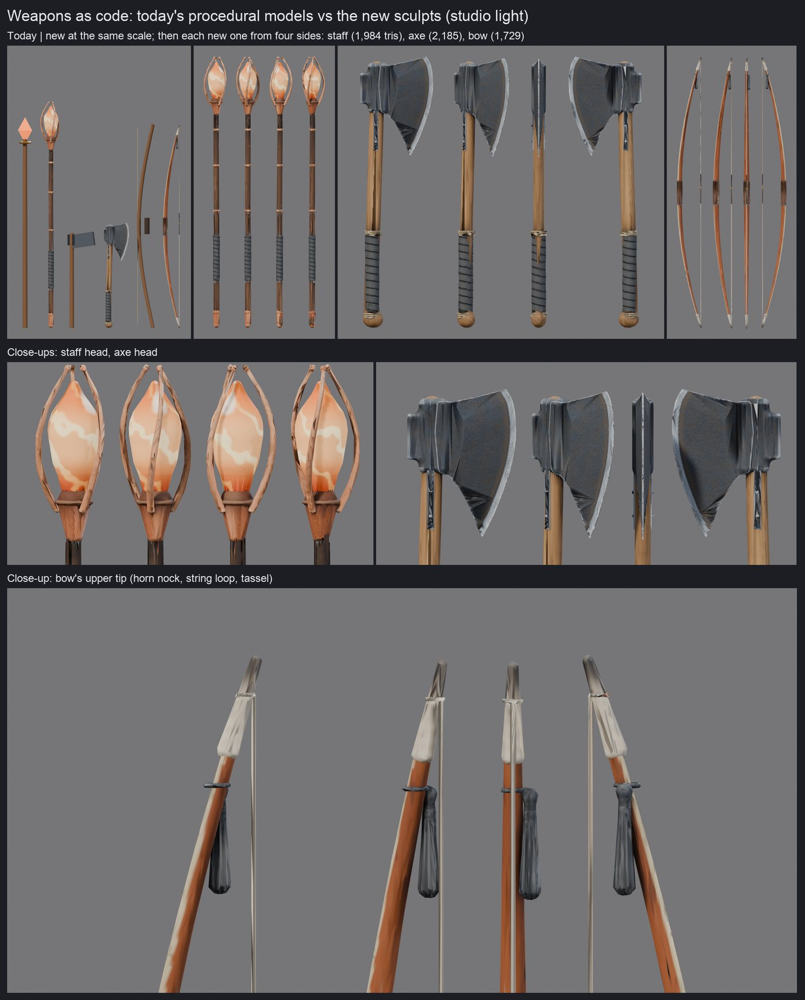
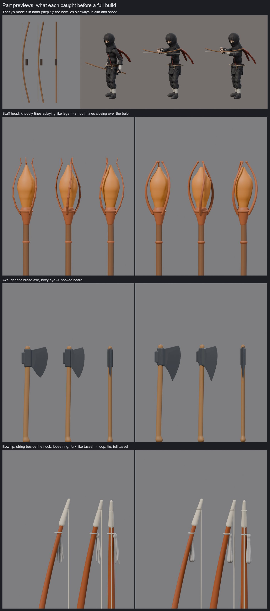
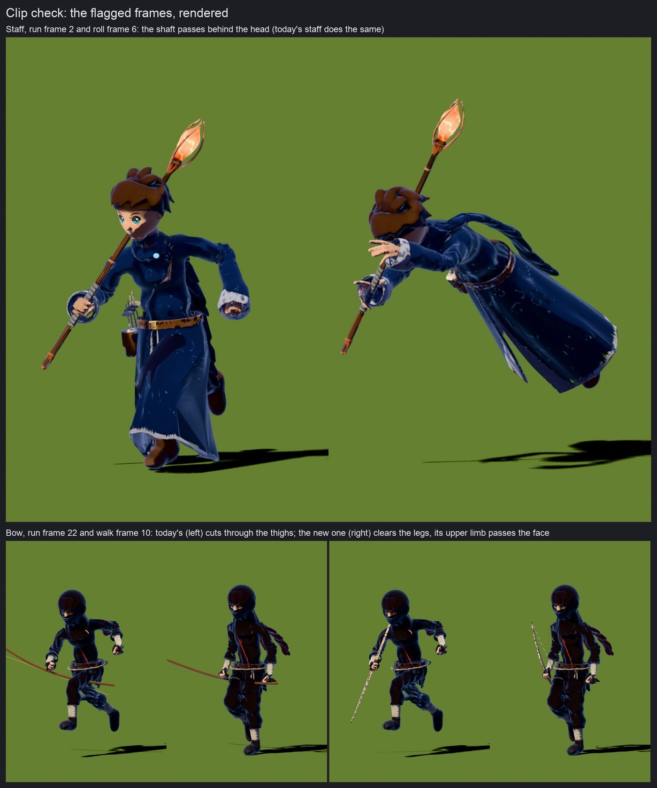
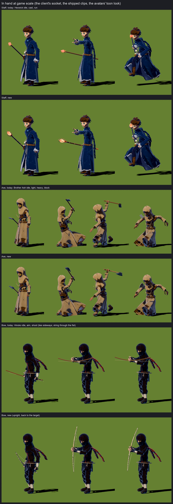

# Models-as-code test 2: three weapons (2026-10-19)

**What:** a second test of the "models as code" method (after the Orla character test, 2026-10-18), this
time on items: the **Emberglass Staff**, the **Bearded Axe** and the **Yew Longbow** (docs/content.md
§2.3). Branch `lane/props-test` in its own worktree, built on `lane/chars-mage` (where the tools are);
not merged, not pushed, nothing in the client changed. Opus did the work; Blender ran headless at low
priority, one job at a time; no Higgsfield or other paid generation.

**Verdict:** worth keeping for hero items, with changes. The new weapons read far better than today's
code-built ones (they replace 56–204-triangle primitive stacks with 1.7–2.2k-triangle sculpts and a
painted 512² texture), and the steps that paid off were the same as for Orla: **part previews** (they
caught nine shape faults before a slow build) and **looking at the weapon in a character's hand in
the clips the game plays**. That second check found a real bug in today's game: **the bow is mounted
sideways**, so in aim and shoot it lies flat with the string through the fist. The new bow is authored
along the axis the client already uses for staffs and stands upright with no client change. The weak
spots are the texture bake on thin blades (the axe's cheeks show creases close up) and texture use on
long, thin props (13–38% of the square texture).

## Numbers

| | Emberglass Staff | Bearded Axe | Yew Longbow |
|---|---:|---:|---:|
| Triangles, today (weapons.ts) | 140 | 56 | 204 |
| Triangles, new | 1,984 | 2,185 | 1,729 |
| GLB, meshopt (same flags as chars3d/build.sh) | 31,140 B | 26,844 B | 23,368 B |
| Albedo WebP 512² / 256² | 69,968 / 41,240 B | 53,274 / 27,716 B | 41,326 / 27,642 B |
| Normal WebP 512² / 256² | 67,194 / 27,074 B | 74,008 / 27,188 B | 75,394 / 29,582 B |
| Texture used (before dilation) | 20% | 38% | 13% |
| Final build, wall clock | 319 s | 419 s | 413 s |
| Clip-check flags, today → new | 5 → 5 | 7 → 7 | **20 → 6** |

Per weapon that is about 140–170 KB with the 512² set, 80–100 KB with the 256² set. Today's weapons
cost no download at all (they are built in code), so moving all 17 modelled families in §2.3 over would
add about 2.5 MB at 512² (1.5 MB at 256²) unless they share textures.

**Time** (wall clock, the owner's Mac): 23:54 worktree; until 00:14 reading the client's weapon and socket
code, dumping today's models from `weapons.ts`, the in-hand reference previews (which needed a clips
bridge, below); 00:14–00:24 staff previews (five rounds); 00:26–00:38 first staff build (761 s); 00:38–
00:44 axe and bow previews (six rounds); 00:45–00:57 first axe and bow builds; the Codex review ran
alongside; 00:58–01:22 fixes and a rebuild of all three; 01:22–01:31 renders and clip checks; 01:32–01:39
the clip checks again after a checker fix; contact sheets at 01:40. About 1 h 50 min to the sheets, then
this report. **The
machine was saturated by other threads the whole time** (load average 250 at 00:35, another thread's
town build running two Blender processes plus headless Chrome), so every Blender time here is inflated:
the same staff build took 761 s at the start and 319 s later; one UV pack took about 5 minutes.

## Step by step: what worked and what didn't

1. **Brief, feel references and the IP avoid list in each recipe header.** *Worked.* The tie-breakers
   made decisions for me: "the glow is the point" made the staff's head grow 30% when it read as a dot
   at character scale; "the bright edge against the dark head reads at 10 m" set the axe's paint; "the
   two-tone wood is the character" set the bow's. Avoid lists (Tolkien staffs and elven bows, God of
   War's Leviathan Axe, Marvel's Stormbreaker and Hawkeye, Zelda's bows, Brave, The Hunger Games; no
   runes or lettering) kept the designs plain and our own; Codex found no conflict with §8.2 or §10.
2. **Today's models as the reference, in the hand (new for items).** `weapons.ts` builds its models in
   code, so a 30-line Node script dumps them to JSON and Blender rebuilds them; `hold.py` copies the
   client's right-hand socket (`Avatars.ts` SOCKETS.hand_r and its rest axes). *Worked, and found the
   bow bug before any sculpting:* today's bow runs its limbs along weapon +Y, which the aim and shoot
   clips turn sideways. *Didn't work at first:* the shipped `starters_anims.glb` is a bare node tree with
   no skin, which Blender imports as 65 animated empties, not an armature. `clips.py` now drives a
   character's armature from those nodes (fixed rest offsets from the GLB's own node data).
3. **Part-by-part previews, upright plus held at clip frames** (`preview_prop.py`; 1–2 minutes each
   under the load). *Worked best again.* Faults caught before a full build: a staff shaft that read as
   bamboo (grain noise too regular along it), a head too small to read at character scale, knobbly
   tines that splayed out like insect legs, then bent at corners (fixed with a spline resample); an axe
   that read as a generic broad axe twice (the beard's underside needs to be scooped above the straight
   line, or there is no hook) and a box-like eye; a bowstring stopping beside the nock, a tie ring
   floating off the limb (tightened; it still sits a little loose on the flat back) and a tassel like a
   fork. Held previews confirmed the new bow stands upright,
   its back to the target. *Didn't catch:* texture faults, which only appear after the bake.

   
4. **Build: sculpt, cull, decimate, UVs, bake a 512² albedo + normal, static GLB** (`build_prop.py`,
   which reuses the character build's helpers; `build.sh` adds meshopt and WebP). *Mostly worked.* The
   first textured build showed four faults, fixed in the rebuild: on the thin axe blade the bake's
   projection landed on the far face (dark creases; now rejected when the normals disagree); 720 triangles
   were too few for the curved cheek (now 1,200); the haft end poked out of the eye as a loose cap; the
   cut edge where the haft enters the eye showed as teeth (culled deeper now). *Still not right:* close
   up, the axe's cheeks keep faceted dark patches (most likely the normal map baked against large
   low-poly triangles; it does not show at game scale, see the hand shots), and long thin props waste
   their square texture (the bow used 8%; cutting long UV islands into bands raised it to 13%).
5. **Clip check for a held prop** (`prop_check.py`): plays the clips the game uses for that weapon
   class on a shipped character, with the weapon in the socket, and measures how deep the weapon goes
   into capsules around the body; today's model goes through the same check. *Worked, after a fix of its
   own.* The first run said today's staff never touched the body; rendering the flagged frames showed
   why that was wrong: the checker tested vertices only, and today's shafts are cylinders with vertices
   at their two ends, so a 1.4 m shaft could pass through a head unseen. It now samples every triangle
   every 1.5 cm. Results (game metres, at each character's client scale):
   - **Bow, 20 → 6:** today's bow cuts through the thighs in walk, run, land and hit (6–7 cm); the
     upright one clears the legs.
   - **Staff 5 → 5, axe 7 → 7:** the same frames in both models: the shaft or head passes behind or
     through the head in run, sprint and roll (8–10 cm), and the axe goes into the left leg at the end
     of the heavy swing. These come from holding every long weapon through the fist in the bare-hands
     locomotion clips, not from the new models (the bigger new axe head goes up to 2.5 cm deeper in run).
     Fixing them is client work: a different hold or a holster pose while running, or weapon-class run
     clips.

   
6. **Contact sheets** (`render_prop.py` compare, turnaround, close-up and hand modes; chars3d's
   `contact_sheet.py`). *Worked.* The in-hand sheet uses the avatars' toon look; today's models get the
   same toon shading there so the comparison is about shape and colour (the client draws them with a PBR
   material).

   

## Codex review (gpt-6.1-sol, high, standard speed)

No blockers. It confirmed the axis conversions, the socket copy, the clips bridge's matrix maths, the
bow's orientation against `GUN_GRIP`, and that the `render.py` refactor leaves character renders
unchanged. Four findings, all accepted and fixed:

1. **Clips played at 24 fps.** Blender's importer turns clip seconds into frames at the scene's rate,
   and the scripts reset to the factory 24; the characters' pipeline is 30. Every requested frame was
   the wrong moment. Now 30.
2. **Clip-check depths ignored the client's model scale** (Hexwick 0.95, Ash 1.04, Hinoko 0.96). Depths
   are now reported in game metres; the header no longer claims that a shared flag proves its cause.
3. **Today's models lost their glow colour in the toon comparison.** Base and emission are now kept
   apart.
4. **A noise displacement exceeded its declared slope** (nit); the divisor is now conservative.

The first render queue also started early (its wait pattern missed `build.sh`), ran two Blender jobs at
once for a few minutes and failed on the not-yet-built bow; I stopped it and chained renders after the
build in one script.

## What to keep in a future project skill (characters and items)

Keep, in this order:
1. The recipe header: brief, 2–3 feel references, tie-breakers, the §8.2/§10 avoid list.
2. For items: today's model as a reference, rendered in the hand in the clips its weapon class plays,
   before sculpting.
3. Part previews, upright and **held in the hand at clip frames** (for characters: posed at a clip frame),
   one fix and one preview at a time.
4. The build, then a close-up render **and** a game-scale render: some faults only show close up (the
   axe's creases), some only in the hand.
5. A clip check after every build, run on the old model too, and **render the worst flagged frames
   before acting**: twice now a flag (or a missing one) came from the checker, not the model.
6. A Codex review before the final build.
7. Contact sheets as the closing gate.

Change before reusing:
- Long, thin props need a non-square texture or a shared trim texture; one 512² square wastes most of
  itself on a bow.
- The thin-blade bake needs a proper fix (bake the normal map against the final triangles' own tangent
  frame, or give blades more triangles near the eye).
- Factor the bake loop shared by `chars3d/build.py` and `props3d/build_prop.py` into one function.
- Keep simple props (tonics, the radio) in code; this method costs 1–2 h per item and ~150 KB each.

To ship any of these weapons, the client would need: a GLB path for weapons in `Avatars.ts` (the socket
and axes are unchanged, the new bow included), the avatars' toon material with the glow rule (albedo
alpha = 1 − glow, the painted colour glows) and the Role palette tint, and the 256² set on Low.

## Files

Branch `lane/props-test`: `tools/blender/props3d/` (`build_prop.py`, `build.sh`, `preview_prop.py`,
`render_prop.py`, `prop_check.py`, `clips.py`, `hold.py`, `ppaint.py`, `shapes.py`,
`items/{emberglass,axe,longbow}.py`); chars3d: main guards in `render.py`, `preview_parts.py` and
`clip_check.py`, `render.py`'s lighting half shared as `finish_material()`, WebP Low sets named by size
(characters' names unchanged). Results next to this report: the stats and clip-check JSON per weapon.
Built files are not in git; they were in `/tmp/fl-props/` on the night (raw/, stage/, sheet/).
